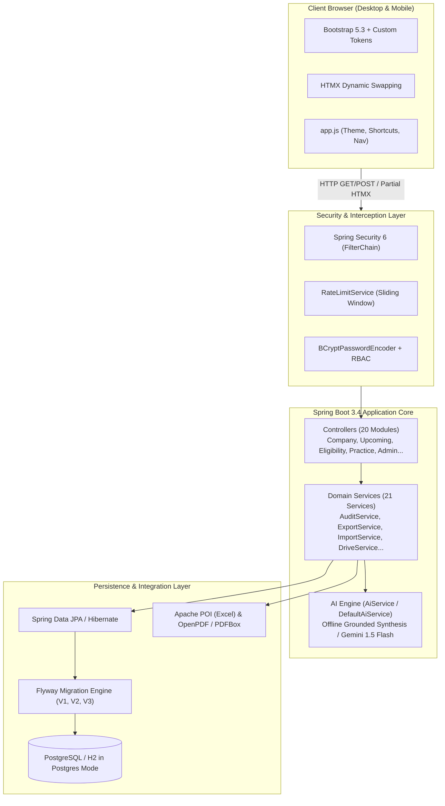
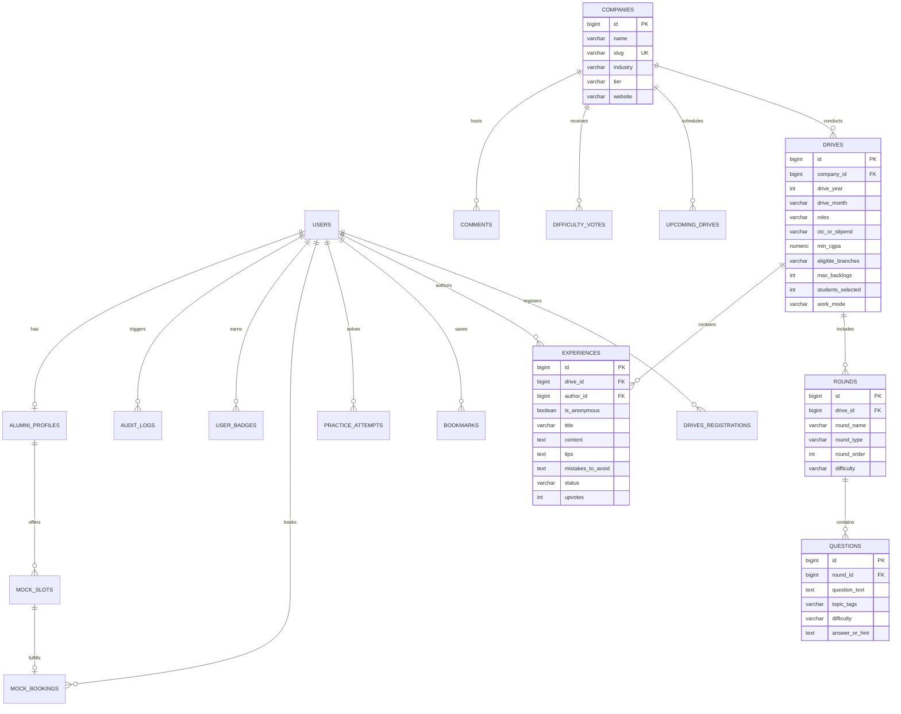

# You_can — Institutional Campus Placement Intelligence & Preparation Platform

<div align="center">

[](https://www.oracle.com/java/)
[](https://spring.io/projects/spring-boot)
[](https://www.postgresql.org/)
[](https://www.thymeleaf.org/)
[](https://htmx.org/)
[](https://getbootstrap.com/)
[]()

<br/>

**A production-grade, privacy-first university recruitment intelligence engine and placement preparation suite designed for JECRC University students, placed alumni mentors, and institutional placement cell administrators.**

[📘 Master Documentation](DOCUMENTATION.md) • [🗺️ Visual Sitemap](SITEMAP.md) • [📜 Changelog](docs/CHANGELOG.md) • [🏗 Architecture](docs/ARCHITECTURE.md) • [Explore Features](#-feature-matrix--deep-dive) • [Local Setup](#-installation--local-deployment) • [API Routes](#-api--route-catalogue)

</div>

---

## 📖 Executive Summary & Problem Context

At top universities, campus recruitment knowledge is historically **fragmented and ephemeral**:
- **Knowledge Flight**: Graduating seniors leave campus with vital interview insights, round-by-round specifics, and coding questions that are lost each year.
- **Preparation Blind Spots**: Juniors prepare blindly without historical data on which companies visit in which months, typical round counts, or company-specific cutoffs.
- **Information Silos**: Unofficial WhatsApp groups and informal spreadsheets lack verification, searchability, and institutional retention.
- **Placement Cell Overhead**: Coordinating announcement deadlines, validating multi-branch eligibility cutoffs, tracking mock interview slots, and compiling annual placement audit reports requires immense manual labor.

**You_can** solves this systematically by delivering a **centralized institutional platform** that pairs historical recruitment transparency with proactive student preparation tools and automated placement cell governance.

---

## 📑 Table of Contents
1. [System Architecture](#-system-architecture)
2. [Database & Domain Model](#-database--domain-model)
3. [Feature Matrix & Deep Dive](#-feature-matrix--deep-dive)
   - [Recruitment Archive & Directory](#1-recruitment-archive--directory)
   - [Automated Eligibility Evaluator & What-If Engine](#2-automated-eligibility-evaluator--what-if-engine)
   - [Question Bank & Interactive Practice Suite](#3-question-bank--interactive-practice-suite)
   - [Prep Roadmaps, Checklists & Resume Scanner](#4-prep-roadmaps-checklists--resume-scanner)
   - [Alumni Mentors & Mock Interview Booking](#5-alumni-mentors--mock-interview-booking)
   - [Student Dashboard & Contributor Gamification](#6-student-dashboard--contributor-gamification)
   - [Placement Cell Admin Console & Audit Engine](#7-placement-cell-admin-console--audit-engine)
   - [AI Intelligence Layer (Phase 4)](#8-ai-intelligence-layer-phase-4)
   - [Mobile-First UX & Design System](#9-mobile-first-ux--design-system)
4. [Security, Privacy & Governance](#-security-privacy--governance)
5. [Technology Stack](#-technology-stack)
6. [Repository & Package Structure](#-repository--package-structure)
7. [Installation & Local Deployment](#-installation--local-deployment)
8. [Default Seed Credentials](#-default-seed-credentials)
9. [API & Route Catalogue](#-api--route-catalogue)
10. [Configuration Reference](#-configuration-reference)

---

## 🏗️ System Architecture

**You_can** is deliberately engineered as a **modular Server-Side Rendered (SSR) monolithic application** using **Spring Boot 3.4** and **Thymeleaf**, augmented with **HTMX** for instant, reactive single-page app (SPA) performance without the maintenance complexity of a separate JavaScript frontend bundle.



### Architectural Highlights
- **Zero Frontend Build Step**: No Node.js/Webpack build chain required. Pure CSS custom variables, Thymeleaf templates, and HTMX partial fragment swaps (`hx-get`, `hx-target`, `hx-swap="outerHTML"`) handle asynchronous search and filtering under 50ms.
- **PostgreSQL / H2 Parity**: Defaults to embedded file-based H2 in PostgreSQL compatibility mode for instant local testing, seamlessly switching to managed PostgreSQL in production via environment variable injection.
- **Graceful Offline Degradation**: The entire application, including AI intelligence modules, operates completely offline without external network dependencies.

---

## 🗄️ Database & Domain Model

The relational schema is managed through versioned **Flyway database migrations** (`classpath:db/migration`), establishing complete data integrity, foreign key constraints, cascading policies, and automated indexing.



---

## 🌟 Feature Matrix & Deep Dive

### 1. Recruitment Archive & Directory
- **Instant Directory Search**: Debounced live searching across company names, roles, and technologies via HTMX (`hx-trigger="input delay:350ms"`).
- **Multi-Faceted Filtering**: Filter concurrently by visiting Year, Month, Industry (e.g. IT, FinTech, Consulting, Analytics), Job Type (Placement, Internship, Both), Branch Eligibility, and CTC ranges.
- **Multi-Param Sorting**: Sort by Most Recent Visit, Most Frequent Recruiter, Highest CTC Package, and Difficulty Rating.
- **Deep-Dive Company Pages**:
  - Visit chronology with student selection numbers.
  - Round-by-round selection breakdown (Coding Round, Technical Interview 1/2, Managerial, HR).
  - Categorized interview questions with revealable hints and complexity breakdowns.
  - Community difficulty rating (1 to 5 stars) with user vote caching.

### 2. Automated Eligibility Evaluator & "What-If" Engine
- **Instant Eligibility Calculation**: Compares the authenticated student's profile (CGPA, Branch, and Backlog count) against real company criteria.
- **Exclusion Cause Highlighting**: If a student is ineligible, explicit color-coded reasons are flagged (e.g. *"Requires CGPA 7.50 (Your score: 7.20)"* or *"Active backlogs exceeded: allowed 0, you have 1"*).
- **Interactive "What-If" Simulator**:
  - Lets students simulate changes to their CGPA, active backlogs, or target branch without altering their profile.
  - Instantly recalculates eligible companies and upcoming drives to provide clear preparation targets.

### 3. Question Bank & Interactive Practice Suite
- **Comprehensive Question Bank**: Filter thousands of verified campus interview questions by company, difficulty (EASY, MEDIUM, HARD), topic (DSA, DBMS, OS, Networks, OOP, System Design, HR), and round type.
- **Focus Practice Mode**:
  - One-at-a-time interactive question interface.
  - On-demand solution/hint drawer.
  - Interactive self-assessment: students mark attempts as **Solved**, **Unsure**, or **Skipped**.
  - Persistent progress tracking highlighting weak topics in the student cockpit.

### 4. Prep Roadmaps, Checklists & Resume Scanner
- **Dynamic 1-to-8 Week Prep Roadmaps**: Enter a company and target preparation duration (1 to 8 weeks) to generate a structured weekly curriculum linked directly to relevant Question Bank practice categories.
- **Company Preparation Checklists**: Checklists generated from a company's past round patterns and recurrent question topics.
- **Resume Quality Scanner**:
  - Secure PDF resume upload (validated for MIME type and 5MB limit).
  - Automated checklist evaluation inspecting contact info presence, length, project metrics, and technical skill balance.
  - Optional consent toggle for placed students to share anonymized resumes as reference templates for juniors.

### 5. Alumni Mentors & Mock Interview Booking
- **Opt-In Alumni Directory**: Searchable list of placed seniors and alumni with graduation year, company, role, LinkedIn handle, and areas of expertise.
- **1-on-1 Mock Interview Slot System**:
  - Placed seniors set availability time slots.
  - Juniors book slots with an interview agenda.
  - Automated status management (AVAILABLE, BOOKED, COMPLETED, CANCELLED).
  - Add to Calendar (`.ics`) file generation for both student and mentor.

### 6. Student Dashboard & Contributor Gamification
- **Personalized Student Cockpit**: Consolidated view of upcoming eligible drives, application deadlines within 48 hours, bookmarks, and weak topic alerts.
- **Community Gamification**:
  - Points awarded for approved experience submissions (+50 pts) and community upvotes (+5 pts).
  - Badges: *First Contributor*, *Master Solver*, *Community Mentor*, *Verified Placed*.
  - Annual Contributor Leaderboard (anonymized contributions excluded from public leaderboards to preserve privacy).

### 7. Placement Cell Admin Console & Audit Engine
- **Comprehensive Administrative CRUD**: Full control over companies, drives, rounds, questions, and upcoming drive notices.
- **Moderation Approval Queue**: Review student experiences before public display, complete with rejection feedback loop.
- **Bulk Data Import Engine**:
  - Upload historical data via CSV or Excel (`.xlsx`) using Apache POI and OpenCSV.
  - Pre-commit dry-run validation displaying row-level syntax and relationship errors before writing to the database.
- **Administrative Audit Trail**: Every create, edit, delete, and moderation event is logged into the `audit_logs` table with actor email, entity type, target ID, and timestamp.
- **One-Click Placement Reports**: Export institutional placement reports to Excel (`.xlsx`) and PDF formatted for university accreditation.

### 8. AI Intelligence Layer (Phase 4)
- **AI-1 Experience Summarizer**: Automatically generates an institutional "What to Expect" summary on company detail pages synthesizing multiple senior experiences into interview patterns, focus areas, and traps to avoid.
- **AI-2 Question Classifier**: Automatically classifies question text into core subject domains (DSA, DBMS, OS, Networks, System Design, HR) and suggests difficulty ratings for admin and contributor confirmation.
- **AI-3 Grounded Prep Chatbot**: Answers student preparation inquiries strictly using the portal's verified campus database (resumes, personal emails, and anonymous identities are never exposed). Explicitly responds with *"I don't have verified data on that in our campus recruitment records"* to prevent hallucinations.
- **Offline / Hybrid Flexibility**: Works completely offline using intelligent heuristic synthesis, and seamlessly upgrades to live Google Gemini (`gemini-1.5-flash`) when an API key is configured.

### 9. Mobile-First UX & Design System
- **Curated Design Tokens**: Bespoke Indigo & Slate color palette with glassmorphism backdrop blur (`backdrop-filter: blur(16px)`).
- **Mobile Bottom Navigation Bar**: Ergonomic touch navigation for screens under 768px with dynamic active tab highlighting.
- **Collapsible Filter Drawers**: Advanced multi-attribute filters collapse on mobile devices into a single touch button to prevent vertical scroll fatigue.
- **Accessibility & Productivity**: Keyboard shortcuts (`Ctrl+K` or `/` for instant search focus), smooth theme persistence (`data-bs-theme="dark"`), and floating back-to-top button.

---

## 🔒 Security, Privacy & Governance

| Security Vector | Implementation Detail |
|---|---|
| **Institutional Email Isolation** | Registrations restricted to university email domains (e.g. `@jecrcu.edu.in`, `@university.edu`). Validated at both controller and service layers. |
| **Password Security** | Passwords hashed using industry-standard **BCrypt** with adaptive work factor. |
| **Role-Based Access Control (RBAC)** | Strict URL authorization rules enforcing `ROLE_ADMIN` on `/admin/**` and authenticated session checks on preparation tools. |
| **Author Anonymity Guarantee** | For anonymous submissions, author entity associations are erased in public database queries and export engines; only the admin moderation queue retains authorization auditing. |
| **Rate Limiting** | In-memory sliding window rate limiter protects `/login`, `/contribute`, and `/api/**` against brute-force attacks and comment flooding. |
| **CSRF & Upload Protection** | Cross-Site Request Forgery tokens enforced on all POST/PUT/DELETE forms. File uploads restricted to validated PDF extensions with 5MB file caps stored outside the web root. |

---

## 🧰 Technology Stack

```text
Core Backend Runtime
├── Java 21 LTS (Amazon Corretto / Oracle OpenJDK)
└── Spring Boot 3.4.3
    ├── spring-boot-starter-web (REST & MVC)
    ├── spring-boot-starter-thymeleaf (Server-side rendering)
    ├── spring-boot-starter-data-jpa (Hibernate ORM)
    ├── spring-boot-starter-security (Spring Security 6)
    ├── spring-boot-starter-validation (Hibernate Validator)
    ├── spring-boot-starter-mail (SMTP mailer)
    └── spring-boot-starter-actuator (Health & metrics)

Database & Migrations
├── PostgreSQL (Production Driver)
├── H2 Database (In-Memory / File-based PostgreSQL compatibility)
└── Flyway 10.x (Automated schema migration pipeline)

Document Processing & Utilities
├── Apache POI 5.3.0 & poi-ooxml (Excel import/export)
├── OpenCSV 5.9 (High-performance CSV parsing)
├── OpenPDF 2.0.3 (Vector PDF placement reports)
├── Apache PDFBox 3.0.3 (Resume text extraction and validation)
└── Project Lombok 1.18.40 (Boilerplate reduction)

Frontend Interface
├── Thymeleaf Layout Dialect & Extras Spring Security 6
├── HTMX 1.9.10 (Instant AJAX search, partial swaps)
├── Bootstrap 5.3.3 & Bootstrap Icons 1.11
└── Vanilla JavaScript ES6+ (app.js)
```

---

## 📁 Repository & Package Structure

```text
Placement_Helper/
├── .mvn/wrapper/                            # Maven wrapper executable binaries
├── data/                                    # Local file database directory (git-ignored)
├── uploads/resumes/                         # Secure resume file storage (git-ignored)
├── src/
│   ├── main/
│   │   ├── java/in/jecrcu/placement/
│   │   │   ├── YouCanApplication.java       # Spring Boot main entry point
│   │   │   ├── config/                      # SecurityFilterChain, DataInitializer, CustomUserDetails
│   │   │   ├── controller/                  # Web Controllers
│   │   │   │   ├── AdminController.java     # Placement cell moderation, CRUD & imports
│   │   │   │   ├── AlumniController.java    # Alumni mentor directory
│   │   │   │   ├── AuthController.java      # Sign In, Registration, Password Reset
│   │   │   │   ├── BookmarkController.java  # Company and question bookmarks
│   │   │   │   ├── CalendarController.java  # Recruitment calendar & heatmaps
│   │   │   │   ├── CompanyController.java   # Directory, HTMX fragments & detail pages
│   │   │   │   ├── ComparisonController.java# Side-by-side recruiter comparison
│   │   │   │   ├── ContributeController.java# Experience submission flow
│   │   │   │   ├── DashboardController.java # Student personal cockpit
│   │   │   │   ├── EligibilityController.java# Real-time eligibility & What-If simulator
│   │   │   │   ├── MockInterviewController.java# Slot scheduling and bookings
│   │   │   │   ├── PracticeController.java  # Interactive question practice mode
│   │   │   │   ├── QuestionBankController.java# Campus question repository
│   │   │   │   ├── ResumeController.java    # Resume checklist evaluation
│   │   │   │   ├── RoadmapController.java   # Custom week-by-week prep roadmaps
│   │   │   │   ├── StatsController.java     # Placement metrics & analytics
│   │   │   │   └── UpcomingController.java  # Upcoming drives & registrations
│   │   │   ├── entity/                      # JPA Entities (Company, Drive, Question, User...)
│   │   │   │   └── enums/                   # Role, Difficulty, RoundType, Outcome enums
│   │   │   ├── repository/                  # Spring Data JPA Repositories (21 interfaces)
│   │   │   └── service/                     # Service Layer
│   │   │       ├── AuditService.java        # Audit logging engine
│   │   │       ├── EligibilityService.java  # Multi-factor eligibility algorithm
│   │   │       ├── ExportService.java       # Excel and PDF generation
│   │   │       ├── ImportService.java       # CSV and Excel validation & import
│   │   │       ├── RateLimitService.java    # Sliding-window rate limiter
│   │   │       └── ai/                      # AI Intelligence Engine
│   │   │           ├── AiService.java       # AI interface specification
│   │   │           └── DefaultAiService.java# Grounded synthesis & Gemini client
│   │   └── resources/
│   │       ├── application.properties       # Environment configuration & feature flags
│   │       ├── db/migration/                # Flyway SQL scripts (V1 Schema, V2 Seed, V3 Registrations)
│   │       ├── static/                      # Static assets
│   │       │   ├── css/styles.css           # Design tokens, theme palettes, mobile layout
│   │       │   └── js/app.js                # Theme toggler, shortcuts, back-to-top
│   │       └── templates/                   # Thymeleaf HTML Templates
│   │           ├── admin/                   # Admin dashboard, approvals, audit log, imports
│   │           ├── companies/               # Directory, cards fragment, company details
│   │           ├── layout/base.html         # Master shell (navbar, mobile bottom nav, footer)
│   │           └── practice/                # Practice mode and question bank templates
│   └── test/
│       └── java/in/jecrcu/placement/        # Service, Security, and Controller test suites
├── pom.xml                                  # Project Object Model Maven build descriptor
├── PRD University Placement Portal.md       # Full Product Requirements Document (PRD)
└── README.md                                # Platform documentation
```

---

## ⚡ Installation & Local Deployment

### 1. Prerequisites
- **Java 21 JDK** or newer installed (`java -version`)
- **Git** (`git --version`)

### 2. Clone the Repository
```bash
git clone https://github.com/palakpk954/Placement_Helper-You_Can-.git
cd Placement_Helper-You_Can-
```

### 3. Build & Run
Use the embedded Maven wrapper to compile and boot the application:

```bash
# On Linux / macOS:
./mvnw clean spring-boot:run

# On Windows (PowerShell / Command Prompt):
.\mvnw.cmd clean spring-boot:run
```

Once initialized, open your browser and navigate to:  
👉 **`http://localhost:8080`**

*(Flyway automatically applies database migrations and populates initial companies like Google, Microsoft, Amazon, TCS, Deloitte, and historical questions on first boot.)*

### 4. Docker & Cloud Deployment (Render / Production)
The repository includes a multi-stage `Dockerfile` and `.dockerignore` optimized for Java 21 cloud runtimes:

```bash
# Build the Docker image locally
docker build -t youcan-placement-portal .

# Run the container (binds to port 8080)
docker run -p 8080:8080 -e PORT=8080 youcan-placement-portal
```

**Deploying on Render (Free Tier):**
1. Connect your GitHub repository to [Render](https://dashboard.render.com) as a **Web Service**.
2. Select **Runtime: Docker** (Render auto-detects `Dockerfile`).
3. Leave *Build Command* and *Start Command* empty.
4. Render builds the multi-stage image, configures memory limits (`-Xmx384m`), binds to `$PORT`, and serves the live application with free SSL.

---

## 🔑 Default Seed Credentials

The database initializes with the following demonstration accounts:

| User Role | Email Identifier | Password | Access Privileges |
|---|---|---|---|
| **Placement Admin** | `admin@jecrcu.edu.in` | `admin123` | Full control over `/admin/**`, audit log, approvals, CSV imports |
| **Student** | `rahul.sharma@jecrcu.edu.in` | `student123` | Student dashboard, upcoming drives, practice mode, roadmaps, bookmarks |
| **Placed Senior / Mentor** | `alumni.amit@jecrcu.edu.in` | `mentor123` | Verified contributor, alumni profile, mock interview slot management |

*(New student accounts can be registered via `/register` using any email ending with `@jecrcu.edu.in` or `@university.edu`.)*

---

## 📡 API & Route Catalogue

| Route Path | HTTP Method | Access Level | Description |
|---|---|---|---|
| `/` | `GET` | Public / Student | Redirects to `/dashboard` or home |
| `/login` | `GET`, `POST` | Public | User authentication endpoint |
| `/register` | `GET`, `POST` | Public | Student account registration with domain check |
| `/dashboard` | `GET` | Authenticated | Student cockpit with upcoming drives & stats |
| `/companies` | `GET` | Authenticated | Company directory with multi-attribute filtering |
| `/companies/fragment` | `GET` | Authenticated | HTMX dynamic partial update for company cards |
| `/companies/{id}` | `GET` | Authenticated | Company detail page, visit rounds & questions |
| `/companies/{id}/vote` | `POST` | Authenticated | Submit 1–5 star difficulty rating |
| `/upcoming` | `GET` | Authenticated | Upcoming campus drives with eligibility badges |
| `/upcoming/{id}/register`| `POST` | Authenticated | Register student for upcoming campus drive |
| `/upcoming/{id}/ics` | `GET` | Authenticated | Download `.ics` calendar sync file |
| `/eligibility` | `GET` | Authenticated | Real-time eligibility & What-If simulator |
| `/questions` | `GET` | Authenticated | Searchable campus question bank |
| `/practice` | `GET` | Authenticated | Interactive practice mode interface |
| `/practice/{id}/status`| `POST` | Authenticated | Mark question as Solved, Unsure, or Skipped |
| `/roadmap` | `GET`, `POST` | Authenticated | Generate 1-to-8 week preparation roadmap |
| `/compare` | `GET` | Authenticated | Side-by-side comparison of two recruiters |
| `/resume` | `GET`, `POST` | Authenticated | PDF resume checklist scanner |
| `/alumni` | `GET` | Authenticated | Placed alumni mentors directory |
| `/mocks` | `GET`, `POST` | Authenticated | Mentor slot creation and student bookings |
| `/contribute` | `GET`, `POST` | Authenticated | Submit interview experience (anonymous option) |
| `/ai-assistant` | `GET` | Authenticated | Full interactive AI Placement Assistant interface |
| `/api/ai/chat` | `POST` | Authenticated | Grounded institutional recruitment Q&A chatbot API |
| `/api/ai/classify` | `POST` | Authenticated | Automated question domain and difficulty classifier |
| `/api/ai/company-summary/{id}` | `GET` | Authenticated | AI synthesis and preparation summary for a company |
| `/admin` | `GET` | `ROLE_ADMIN` | Placement Cell administration overview |
| `/admin/approvals` | `GET`, `POST` | `ROLE_ADMIN` | Experience submission moderation queue |
| `/admin/audit-log` | `GET` | `ROLE_ADMIN` | Searchable administrative action audit trail |
| `/admin/import` | `GET`, `POST` | `ROLE_ADMIN` | Bulk CSV/Excel data import with dry-run preview |
| `/admin/reports` | `GET` | `ROLE_ADMIN` | Generate and download Excel & PDF placement reports |

---

## ⚙️ Configuration Reference

Application configuration resides in [`src/main/resources/application.properties`](file:///c:/Users/HP/Desktop/Placement_Helper/src/main/resources/application.properties) and can be customized via environment variables:

```properties
# Web Server
server.port=${PORT:8080}

# Database Datasource (Auto-defaults to embedded H2 Postgres mode)
spring.datasource.url=${SPRING_DATASOURCE_URL:jdbc:h2:file:./data/youcan;MODE=PostgreSQL;DATABASE_TO_LOWER=TRUE;DEFAULT_NULL_ORDERING=HIGH;AUTO_SERVER=TRUE}
spring.datasource.username=${SPRING_DATASOURCE_USERNAME:sa}
spring.datasource.password=${SPRING_DATASOURCE_PASSWORD:}

# File Upload Limits
spring.servlet.multipart.max-file-size=5MB
spring.servlet.multipart.max-request-size=10MB
app.upload.dir=./uploads/resumes

# Institutional Domain Validation
app.security.allowed-domains=jecrcu.edu.in,university.edu

# Phase 4 AI Feature Configuration
app.ai.enabled=${APP_AI_ENABLED:false}
app.ai.api-key=${APP_AI_API_KEY:}
app.ai.model=${APP_AI_MODEL:gemini-1.5-flash}
```

---

## 📜 Academic Integrity & Attribution

**You_can** was conceived, architected, and built for **JECRC University** students and placement coordinators.  
Designed to elevate institutional placement outcomes, preserve senior knowledge, and empower every student to achieve their career goals.
