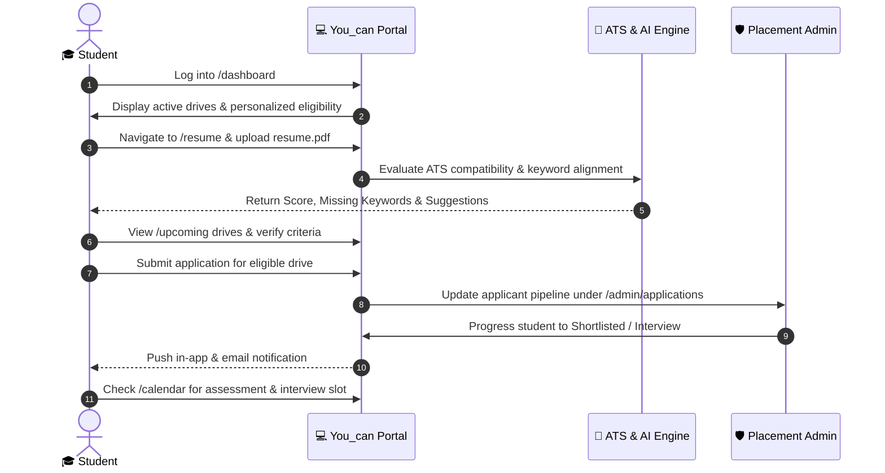
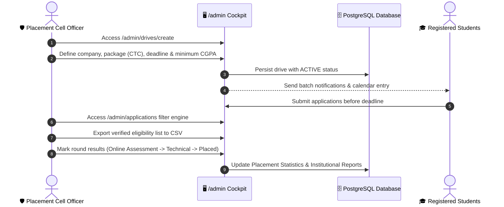

# 🗺️ You_can (Placement Helper) — Application Sitemap & Route Directory

<div align="center">

[](https://github.com)
[]()
[]()
[]()

<br/>

**Comprehensive visual topology, role-based navigation hierarchy, and complete controller-template cross-reference directory for the You_can Campus Placement Portal.**

[🏠 Return to Main Readme](README.md) • [📘 Master Documentation](DOCUMENTATION.md) • [🏗 System Architecture](docs/ARCHITECTURE.md)

</div>

---

## 📑 Table of Contents
1. [Visual Application Topology](#-visual-application-topology)
2. [Role-Based Access Hierarchy](#-role-based-access-hierarchy)
   - [1. Public & Guest Zone](#1-public--guest-zone-unauthenticated)
   - [2. Student Placement Ecosystem](#2-student-placement-ecosystem-role_student)
   - [3. Admin & TPO Placement Cockpit](#3-admin--tpo-placement-cockpit-role_admin)
   - [4. Alumni Mentorship & Community](#4-alumni-mentorship--community-role_alumni)
   - [5. System & AI Services Layer](#5-system--ai-services-layer)
3. [Exhaustive Route & Template Cross-Reference Matrix](#-exhaustive-route--template-cross-reference-matrix)
4. [User Journey Workflows](#-user-journey-workflows)
   - [Student Preparation & Application Lifecycle](#student-preparation--application-lifecycle)
   - [TPO / Admin Placement Drive Lifecycle](#tpo--admin-placement-drive-lifecycle)
5. [Frontend Template Architecture](#-frontend-template-architecture)

---

## 🌐 Visual Application Topology

The diagram below maps the complete structural topology of the platform, showing root routing, role access gates, and functional modules:

```mermaid
flowchart TD
    %% Root Entry
    AppRoot(["🚀 You_can Root URL (/)"]):::rootNode

    %% Access Gateways
    AppRoot --> PublicGate["🌐 Public Zone<br/>(No Auth Required)"]:::publicNode
    AppRoot --> AuthGate["🔐 Security & Auth Gate<br/>(/login, /register)"]:::authNode

    %% Authenticated Ecosystems
    AuthGate -->|Role: STUDENT| StudentGate["🎓 Student Portal<br/>(/dashboard)"]:::studentNode
    AuthGate -->|Role: ADMIN| AdminGate["🛡️ Admin / TPO Cockpit<br/>(/admin)"]:::adminNode
    AuthGate -->|Role: ALUMNI| AlumniGate["🤝 Alumni Network<br/>(/alumni)"]:::alumniNode

    %% Public Submodules
    PublicGate --> PubHome["Landing Page (Hero & Highlights)"]
    PublicGate --> PubStats["/placements/statistics<br/>Official JECRC Placement Analytics"]
    PublicGate --> PubCompanies["/companies<br/>Recruiting Partners Directory"]
    PublicGate --> PubUpcoming["/upcoming<br/>Published Placement Drives"]

    %% Student Submodules
    StudentGate --> StDashboard["/dashboard<br/>Student Control Center"]
    StudentGate --> StDrives["/upcoming & /eligibility<br/>Drive Discovery & Eligibility What-If"]
    StudentGate --> StCalendar["/calendar<br/>Interactive Drive Timeline & Deadlines"]
    StudentGate --> StResume["/resume<br/>AI ATS Scanner & Keyword Matcher"]
    StudentGate --> StOpp["/opportunities<br/>Off-Campus Internships & Hackathons"]
    StudentGate --> StPrep["/practice, /questions, /roadmap<br/>DSA & Interview Prep Hub"]
    StudentGate --> StMocks["/mocks<br/>Book Mock Interviews with Alumni"]
    StudentGate --> StBookmarks["/bookmarks & /checklist<br/>Prep Checklists & Saved Companies"]
    StudentGate --> StContribute["/contribute<br/>Submit Interview Experiences"]

    %% Admin Submodules
    AdminGate --> AdCockpit["/admin<br/>Executive Placement Dashboard"]
    AdminGate --> AdDrives["/admin/drives<br/>Create, Edit, Publish & Close Drives"]
    AdminGate --> AdApps["/admin/applications<br/>Applicant Tracking & Stage Progression"]
    AdminGate --> AdOpp["/admin/opportunities<br/>External Contests & Hackathon Manager"]
    AdminGate --> AdStats["/admin/stats<br/>Year-over-Year Reports & Ingestion Engine"]
    AdminGate --> AdAudit["/admin/audit<br/>Security & Operational Logs"]

    %% Alumni Submodules
    AlumniGate --> AlDirectory["/alumni<br/>Verified Alumni Directory & Company Tags"]
    AlumniGate --> AlSlots["/alumni/slots<br/>Manage Availability for Mock Interviews"]
    AlumniGate --> AlShare["/contribute<br/>Share Verified Placement Stories"]

    %% Service Infrastructure
    AppRoot --> Services["⚙️ Platform Services"]:::coreNode
    Services --> AiService["AI ATS & Evaluation Engine (DeepSeek / Gemini)"]
    Services --> EmailService["Notification & Alert Mailers"]
    Services --> StatEngine["JECRC Multi-Year Analytics Engine"]

    %% Node Styles
    classDef rootNode fill:#0f172a,stroke:#38bdf8,stroke-width:3px,color:#ffffff,font-weight:bold;
    classDef authNode fill:#1e293b,stroke:#f59e0b,stroke-width:2px,color:#f59e0b,font-weight:bold;
    classDef publicNode fill:#1e293b,stroke:#38bdf8,stroke-width:2px,color:#38bdf8,font-weight:bold;
    classDef studentNode fill:#1e293b,stroke:#10b981,stroke-width:2px,color:#10b981,font-weight:bold;
    classDef adminNode fill:#1e293b,stroke:#a855f7,stroke-width:2px,color:#a855f7,font-weight:bold;
    classDef alumniNode fill:#1e293b,stroke:#ec4899,stroke-width:2px,color:#ec4899,font-weight:bold;
    classDef coreNode fill:#0f172a,stroke:#64748b,stroke-width:2px,color:#94a3b8,font-weight:bold;
```



---

## 🔒 Role-Based Access Hierarchy

### 1. Public & Guest Zone (Unauthenticated)
Accessible to everyone without requiring login. Designed to showcase university recruitment achievements, partner companies, and public drives.

| Route | Functionality | Primary View Template |
| :--- | :--- | :--- |
| `/` | Landing page, platform highlights, role quick-launchers | `dashboard.html` |
| `/login` | Secure role-based login (Student, Admin, Alumni) | `auth/login.html` |
| `/register` | Student account registration | `auth/register.html` |
| `/companies` | Directory of verified recruiting partners & past packages | `companies/index.html` |
| `/companies/{slug}` | Deep-dive company profile, past cutoffs, round format | `companies/profile.html` |
| `/placements/statistics`| Official JECRC university placement data & multi-year graphs | `statistics/index.html` |
| `/upcoming` | Public view of active recruitment drives & general eligibility | `upcoming/index.html` |

---

### 2. Student Placement Ecosystem (`ROLE_STUDENT`)
Full suite of self-service recruitment preparation, application tracking, and automated eligibility checking.

```
🎓 /dashboard (Student Hub)
 ├── 🏢 Recruitment & Applications
 │    ├── /upcoming ...................... Browse active on-campus drives
 │    ├── /upcoming/{id} ................. View drive JD, round timeline & apply
 │    ├── /eligibility ................... Auto-check CGPA & branch against criteria
 │    └── /calendar ...................... Unified interactive monthly calendar
 ├── 💼 Off-Campus & Internships
 │    ├── /opportunities ................. Discover hackathons, stipends & off-campus hiring
 │    └── /opportunities/{id} ............ View eligibility criteria & direct application URL
 ├── 🤖 AI Intelligence & Resume Suite
 │    ├── /resume ........................ Upload PDF/DOCX for instant ATS score
 │    ├── /resume/analyze ................ Role-specific keyword matching & gaps
 │    └── /ai/chat ....................... AI Career Assistant for interview prep
 ├── 📚 Skill Practice & Preparation
 │    ├── /practice ...................... Topic-wise DSA & core CS questions
 │    ├── /questions ..................... Company-specific recurring interview questions
 │    ├── /roadmap ....................... Branch-specific 30-day prep roadmaps
 │    └── /checklists .................... Day-of-interview checklist & document prep
 └── 🤝 Alumni Mentorship & Networking
      ├── /alumni ........................ Directory of verified placed seniors
      ├── /mocks ......................... Book 1-on-1 mock interviews with alumni
      ├── /contribute .................... Submit interview experience & questions
      └── /notifications ................. Real-time alerts for shortlists & drive updates
```

---

### 3. Admin & TPO Placement Cockpit (`ROLE_ADMIN`)
Centralized institutional operations console for placement cell officers and department heads.

```
🛡️ /admin (Placement Cell Console)
 ├── 📊 Analytics & Health
 │    ├── /admin ......................... Placement season executive metrics & KPIs
 │    ├── /admin/stats ................... Ingest & inspect multi-year JECRC placement data
 │    └── /admin/reports ................. Export verified placement records (CSV/Excel)
 ├── 📢 Drive Operations
 │    ├── /admin/drives .................. Manage all on-campus placement drives
 │    ├── /admin/drives/create ........... Create new hiring drive with multi-tier cutoffs
 │    ├── /admin/drives/{id}/edit ........ Edit rounds, package (LPA), dates, and branches
 │    └── /admin/drives/{id}/status ...... Publish, pause, or close drive applications
 ├── 👥 Applicant Tracking System (ATS)
 │    ├── /admin/applications ............ Master applicant pipeline across all companies
 │    ├── /admin/applications/filter ..... Filter applicants by CGPA, branch, backlogs
 │    └── /admin/applications/update ..... Transition student stage (Applied -> Shortlisted -> Placed)
 ├── 🌐 External Opportunities Hub
 │    ├── /admin/opportunities ........... Add & moderate national hackathons & contests
 │    └── /admin/opportunities/toggle .... Control publication status & target batch
 └── 🛡️ Governance & Moderation
      ├── /admin/experiences ............. Review & approve student-contributed interview tips
      └── /admin/audit ................... System event logs & role activity history
```

---

### 4. Alumni Mentorship & Community (`ROLE_ALUMNI`)
Dedicated module for placed graduates to give back, offer referrals, and conduct mock interviews.

| Route | Capability | View Template |
| :--- | :--- | :--- |
| `/alumni` | Search alumni by company (Google, Amazon, TCS, etc.), role & passout year | `alumni/index.html` |
| `/alumni/{id}` | Detailed alumni profile, current employer, verified badge | `alumni/profile.html` |
| `/alumni/slots` | Alumni sets available time slots for conducting mocks | `alumni/slots.html` |
| `/contribute` | Post comprehensive breakdown of rounds, CTC breakdown & questions | `contribute/index.html` |

---

### 5. System & AI Services Layer
Headless service APIs powering real-time asynchronous UI features (via HTMX and REST).

| Endpoint | Method | Service Provider | Description |
| :--- | :--- | :--- | :--- |
| `/api/resume/upload` | `POST` | `DefaultAiService` | Extracts resume text and performs ATS grading |
| `/api/ai/evaluate` | `POST` | `AiService` (DeepSeek/Gemini) | Semantic role keyword match & improvement tips |
| `/api/notifications/unread`| `GET` | `NotificationService` | Real-time badge counter for unread alerts |
| `/api/notifications/{id}/read`|`POST`| `NotificationService` | Marks specific announcement or alert as read |
| `/api/bookmarks/toggle` | `POST` | `BookmarkService` | Quick toggle saved company or drive |

---

## 📋 Exhaustive Route & Template Cross-Reference Matrix

The table below lists every Spring Boot controller in `in.jecrcu.placement.controller` alongside its mapped routes and Thymeleaf templates:

| Controller | Primary Routes | Primary Templates | Required Authority |
| :--- | :--- | :--- | :--- |
| `AuthController` | `/login`, `/register`, `/logout` | `templates/auth/*` | `permitAll()` |
| `DashboardController` | `/`, `/dashboard` | `templates/dashboard.html` | `ROLE_STUDENT` or Public |
| `UpcomingController` | `/upcoming`, `/upcoming/{id}`, `/upcoming/apply` | `templates/upcoming/*` | Public / `ROLE_STUDENT` |
| `CompanyController` | `/companies`, `/companies/{slug}` | `templates/companies/*` | Public |
| `StatsController` | `/placements/statistics` | `templates/statistics/*` | Public |
| `CalendarController` | `/calendar` | `templates/calendar/*` | Authenticated |
| `OpportunityController` | `/opportunities`, `/opportunities/{id}` | `templates/opportunities/*` | `ROLE_STUDENT` |
| `ResumeController` | `/resume`, `/resume/analyze` | `templates/resume/*` | `ROLE_STUDENT` |
| `ResumeApiController` | `/api/resume/*` | JSON Response | `ROLE_STUDENT` |
| `AiController` | `/ai/chat`, `/ai/tips` | `templates/ai/*` | `ROLE_STUDENT` |
| `EligibilityController` | `/eligibility`, `/eligibility/check` | `templates/eligibility/*` | `ROLE_STUDENT` |
| `AlumniController` | `/alumni`, `/alumni/{id}` | `templates/alumni/*` | Authenticated |
| `MockInterviewController` | `/mocks`, `/mocks/book`, `/mocks/cancel` | `templates/mocks/*` | `ROLE_STUDENT` / `ALUMNI` |
| `PracticeController` | `/practice`, `/practice/{topic}` | `templates/practice/*` | `ROLE_STUDENT` |
| `QuestionBankController` | `/questions`, `/questions/{company}` | `templates/questions/*` | `ROLE_STUDENT` |
| `RoadmapController` | `/roadmap`, `/roadmap/{role}` | `templates/roadmap/*` | `ROLE_STUDENT` |
| `ChecklistController` | `/checklists` | `templates/checklists/*` | `ROLE_STUDENT` |
| `ContributeController` | `/contribute`, `/contribute/submit` | `templates/contribute/*` | Authenticated |
| `ComparisonController` | `/compare` | `templates/compare/*` | Authenticated |
| `LeaderboardController` | `/leaderboard` | `templates/leaderboard/*` | Authenticated |
| `NotificationController` | `/notifications`, `/api/notifications/*` | `templates/notifications/*` | Authenticated |
| `BookmarkController` | `/bookmarks`, `/api/bookmarks/*` | `templates/dashboard.html` | `ROLE_STUDENT` |
| `AdminController` | `/admin/**` | `templates/admin/*` | `ROLE_ADMIN` |

---

## 🔄 User Journey Workflows

### Student Preparation & Application Lifecycle



---

### TPO / Admin Placement Drive Lifecycle



---

## 🎨 Frontend Template Architecture

All views in the application inherit from a unified, modern design system:

```
frontend/templates/
├── layout/
│   ├── base.html ............... Primary master template (Navbar, Head, Scripts, Footer)
│   └── admin-base.html ........ Specialized admin shell with collapsible sidebar
├── fragments/
│   ├── navbar.html ............. Responsive navigation bar with role detection
│   ├── footer.html ............. Application footer with quick links & version
│   ├── alerts.html ............. Toast notifications & flash alert banners
│   └── modals.html ............. Reusable confirmation & details dialogs
├── dashboard.html .............. Main student landing & widget center
├── error.html .................. Custom branded 403, 404, 500 error pages
└── [module-directories]/ ....... Feature-specific templates matching controllers
```

---

## 📌 Document Versioning

- **Document:** `SITEMAP.md`
- **Associated Codebase:** `Placement_Helper` (`You_can`)
- **Generated:** October 2026
- **Architecture Standard:** Clean SSR Monolith with Spring Boot 3.4 & Thymeleaf
