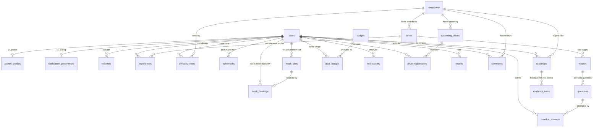

# 🗄️ Database Schema & Data Dictionary Specification
> **Project**: You_can — JECRC University Placement & Career Readiness Portal  
> **Version**: 1.0.0 (Flyway Migrations `V1` – `V7`)  
> **Database Engines**: Embedded H2 (Development, PostgreSQL Dialect Mode) / PostgreSQL 15+ (Production)  
> **ORM Layer**: Spring Data JPA / Hibernate 6.x (`ddl-auto=none`, strict migration-driven)  
> **Total Tables**: 26 Tables across 7 Functional Domains  

---

## 📑 Table of Contents
1. [Architecture & Design Principles](#-architecture--design-principles)
2. [Global Entity-Relationship (ER) Diagram](#-global-entity-relationship-er-diagram)
3. [Domain 1: User Identity & Profile Management](#-domain-1-user-identity--profile-management)
4. [Domain 2: Companies & Campus Recruitment Drives](#-domain-2-companies--campus-recruitment-drives)
5. [Domain 3: Interview Rounds & Question Bank](#-domain-3-interview-rounds--question-bank)
6. [Domain 4: Student Interview Experiences & Community](#-domain-4-student-interview-experiences--community)
7. [Domain 5: Personalized Roadmaps & Alumni Mock Interviews](#-domain-5-personalized-roadmaps--alumni-mock-interviews)
8. [Domain 6: Off-Campus Opportunities & Official Historical Records](#-domain-6-off-campus-opportunities--official-historical-records)
9. [Domain 7: Gamification, Moderation & Audit Logs](#-domain-7-gamification-moderation--audit-logs)
10. [Enumerations Reference](#-enumerations-reference)
11. [Performance Indexes & Query Optimization](#-performance-indexes--query-optimization)
12. [Developer Guide & Connection Runbook](#-developer-guide--connection-runbook)

---

## 🏛️ Architecture & Design Principles

1. **Migration-First Governance**: Hibernate's automatic schema modification is disabled (`spring.jpa.hibernate.ddl-auto=none`). All schema changes are strictly version-controlled via Flyway scripts in `src/main/resources/db/migration/`.
2. **Dual-Environment Compatibility**: DDL queries are written in ANSI-SQL compliant PostgreSQL dialect compatible with both local file-backed H2 (`jdbc:h2:file:./data/youcan;MODE=PostgreSQL`) and enterprise PostgreSQL production clusters.
3. **Data Integrity & Cascading**: Foreign keys explicitly specify `ON DELETE CASCADE` for parent-child lifecycles (e.g., deleting a company cascades to its drives, rounds, and roadmaps) and `ON DELETE SET NULL` for auditability/history (e.g., audit log actors, upcoming drive links).
4. **Idempotence & Anti-Duplication**: Multi-column composite unique constraints guarantee transactional sanity:
   - `(user_id, upcoming_drive_id)` in `drive_registrations`
   - `(company_id, user_id)` in `difficulty_votes`
   - `(user_id, question_id)` in `practice_attempts`
   - `(user_id, item_type, item_id)` in `bookmarks`

---

## 📊 Global Entity-Relationship (ER) Diagram



---

## 👤 Domain 1: User Identity & Profile Management

Handles authentication, role-based access control (`STUDENT`, `ALUMNI`, `ADMIN`), academic stats for recruitment eligibility, alumni professional networks, and uploaded resumes.

### 1. `users`
Core identity table representing all system principals.
- **Entity**: `in.jecrcu.placement.entity.User`
- **Flyway Source**: `V1__init_schema.sql`

| Column | Data Type | Constraints | Description |
| :--- | :--- | :--- | :--- |
| `id` | `BIGINT` | `PK`, `GENERATED ALWAYS AS IDENTITY` | Unique user surrogate identifier |
| `email` | `VARCHAR(255)` | `NOT NULL`, `UNIQUE` | Official campus email (`@jecrcu.edu.in`) |
| `password` | `VARCHAR(255)` | `NOT NULL` | BCrypt salted hash |
| `full_name` | `VARCHAR(255)` | `NOT NULL` | Full legal name |
| `branch` | `VARCHAR(100)` | `NULLABLE` | Academic stream (e.g. `CSE`, `IT`, `AI_DS`, `ECE`) |
| `graduation_year` | `INT` | `NULLABLE` | Passout cohort year (e.g. `2026`) |
| `cgpa` | `NUMERIC(4,2)` | `NULLABLE` | Cumulative GPA on 10.0 scale |
| `active_backlogs` | `INT` | `DEFAULT 0` | Current uncleared backlogs |
| `role` | `VARCHAR(50)` | `NOT NULL`, `DEFAULT 'ROLE_STUDENT'` | Security role: `ROLE_STUDENT`, `ROLE_ALUMNI`, `ROLE_ADMIN` |
| `email_verified` | `BOOLEAN` | `DEFAULT FALSE` | Email activation status |
| `verification_token` | `VARCHAR(255)` | `NULLABLE` | UUID verification token |
| `token_expiry` | `TIMESTAMP` | `NULLABLE` | Token expiration timestamp |
| `points` | `INT` | `DEFAULT 0` | Gamification rep points for community answers/posts |
| `created_at` | `TIMESTAMP` | `DEFAULT CURRENT_TIMESTAMP` | Account creation audit date |

---

### 2. `alumni_profiles`
Extended profile for alumni mentors offering career guidance and mock interviews.
- **Entity**: `in.jecrcu.placement.entity.AlumniProfile`
- **Flyway Source**: `V1__init_schema.sql`

| Column | Data Type | Constraints | Description |
| :--- | :--- | :--- | :--- |
| `id` | `BIGINT` | `PK`, `GENERATED ALWAYS AS IDENTITY` | Primary key |
| `user_id` | `BIGINT` | `NOT NULL`, `UNIQUE`, `FK ➔ users(id) ON DELETE CASCADE` | 1-to-1 link to user record |
| `company_name` | `VARCHAR(255)` | `NOT NULL` | Current employing organization |
| `job_role` | `VARCHAR(255)` | `NOT NULL` | Designation (e.g. `Software Engineer II`) |
| `graduation_year` | `INT` | `NOT NULL` | Passout year from JECRC |
| `branch` | `VARCHAR(100)` | `NOT NULL` | Degree department |
| `linkedin_url` | `VARCHAR(500)` | `NULLABLE` | Verified LinkedIn profile link |
| `topics_can_help` | `VARCHAR(500)` | `NULLABLE` | Mentorship tags (e.g. `System Design, DSA, Resume Review`) |
| `visible` | `BOOLEAN` | `DEFAULT TRUE` | Visibility in public alumni directory |
| `created_at` | `TIMESTAMP` | `DEFAULT CURRENT_TIMESTAMP` | Registration date |

---

### 3. `resumes`
Uploaded PDF resumes with AI ATS checklist analysis and mentor sharing permissions.
- **Entity**: `in.jecrcu.placement.entity.Resume`
- **Flyway Source**: `V1__init_schema.sql`

| Column | Data Type | Constraints | Description |
| :--- | :--- | :--- | :--- |
| `id` | `BIGINT` | `PK`, `GENERATED ALWAYS AS IDENTITY` | Primary key |
| `user_id` | `BIGINT` | `NOT NULL`, `FK ➔ users(id) ON DELETE CASCADE` | Resume owner |
| `file_path` | `VARCHAR(500)` | `NOT NULL` | Relative disk storage path (`uploads/resumes/...`) |
| `original_filename` | `VARCHAR(255)` | `NOT NULL` | Original user-uploaded file name |
| `file_size` | `BIGINT` | `NOT NULL` | File byte length |
| `share_consent` | `BOOLEAN` | `DEFAULT FALSE` | Permission to showcase to verified recruiters |
| `checklist_result_json` | `TEXT` | `NULLABLE` | JSON blob containing automated ATS audit check results |
| `uploaded_at` | `TIMESTAMP` | `DEFAULT CURRENT_TIMESTAMP` | Upload timestamp |

---

### 4. `notification_preferences`
User communication dispatch settings.
- **Entity**: `in.jecrcu.placement.entity.NotificationPreference`
- **Flyway Source**: `V1__init_schema.sql`

| Column | Data Type | Constraints | Description |
| :--- | :--- | :--- | :--- |
| `id` | `BIGINT` | `PK`, `GENERATED ALWAYS AS IDENTITY` | Primary key |
| `user_id` | `BIGINT` | `NOT NULL`, `UNIQUE`, `FK ➔ users(id) ON DELETE CASCADE` | 1-to-1 link to user |
| `email_drives` | `BOOLEAN` | `DEFAULT TRUE` | Receive new placement drive announcements |
| `email_deadlines` | `BOOLEAN` | `DEFAULT TRUE` | Receive 24h deadline reminder notifications |
| `email_experiences` | `BOOLEAN` | `DEFAULT TRUE` | Receive notifications on shared experiences |
| `email_bookings` | `BOOLEAN` | `DEFAULT TRUE` | Receive mock interview status updates |

---

## 🏢 Domain 2: Companies & Campus Recruitment Drives

Manages recruiting corporate profiles, past hiring drives with criteria, scheduled upcoming on-campus drives, and student registrations.

### 5. `companies`
Recruiter directory containing branding, hiring tiers, and profile links.
- **Entity**: `in.jecrcu.placement.entity.Company`
- **Flyway Source**: `V1__init_schema.sql`, `V6__local_company_logos.sql`, `V7__more_local_company_logos.sql`

| Column | Data Type | Constraints | Description |
| :--- | :--- | :--- | :--- |
| `id` | `BIGINT` | `PK`, `GENERATED ALWAYS AS IDENTITY` | Primary key |
| `name` | `VARCHAR(255)` | `NOT NULL` | Company legal/trade name |
| `slug` | `VARCHAR(255)` | `NOT NULL`, `UNIQUE` | URL slug (e.g. `google`, `microsoft`, `celebal`) |
| `logo_url` | `VARCHAR(500)` | `NULLABLE` | Relative or CDN path to SVG/PNG company logo |
| `industry` | `VARCHAR(100)` | `NOT NULL` | Sector (e.g. `IT Services`, `Fintech`, `Product`) |
| `description` | `TEXT` | `NULLABLE` | Background overview and recruitment pattern |
| `website` | `VARCHAR(500)` | `NULLABLE` | Corporate career URL |
| `tier` | `VARCHAR(50)` | `DEFAULT 'Mass Recruiters'` | Compensation category (`Mass Recruiters`, `Dream`, `Super Dream`) |
| `created_at` | `TIMESTAMP` | `DEFAULT CURRENT_TIMESTAMP` | Record timestamp |

---

### 6. `drives`
Past campus placement drives detailing packages, criteria, and outcomes.
- **Entity**: `in.jecrcu.placement.entity.Drive`
- **Flyway Source**: `V1__init_schema.sql`

| Column | Data Type | Constraints | Description |
| :--- | :--- | :--- | :--- |
| `id` | `BIGINT` | `PK`, `GENERATED ALWAYS AS IDENTITY` | Primary key |
| `company_id` | `BIGINT` | `NOT NULL`, `FK ➔ companies(id) ON DELETE CASCADE` | Associated hiring organization |
| `drive_year` | `INT` | `NOT NULL` | Calendar year (e.g. `2025`) |
| `drive_month` | `VARCHAR(50)` | `NOT NULL` | Calendar month of drive (e.g. `September`) |
| `roles` | `VARCHAR(500)` | `NOT NULL` | Designations offered (e.g. `Associate Software Engineer`) |
| `ctc_or_stipend` | `VARCHAR(255)` | `NOT NULL` | Package description (e.g. `7.5 LPA`, `₹45,000/mo`) |
| `min_cgpa` | `NUMERIC(4,2)` | `DEFAULT 6.00` | Minimum eligibility cutoff GPA |
| `eligible_branches`| `VARCHAR(500)` | `NOT NULL` | Comma-delimited branches (`CSE, IT, ECE`) |
| `max_backlogs` | `INT` | `DEFAULT 0` | Allowed active backlog count |
| `students_selected`| `INT` | `DEFAULT 0` | Total verified candidates chosen |
| `job_type` | `VARCHAR(50)` | `NOT NULL`, `DEFAULT 'PLACEMENT'` | Enum: `INTERNSHIP`, `PLACEMENT`, `FTE_PLUS_INTERN` |
| `joining_location` | `VARCHAR(255)` | `NULLABLE` | Work city/hub (e.g. `Bengaluru`, `Noida`, `Jaipur`) |
| `work_mode` | `VARCHAR(50)` | `DEFAULT 'HYBRID'` | Enum: `ON_SITE`, `REMOTE`, `HYBRID` |
| `bond_details` | `VARCHAR(255)` | `NULLABLE` | Service agreement/bond clause (if any) |
| `conversion_offered`| `BOOLEAN` | `DEFAULT TRUE` | PPO conversion possibility for intern roles |
| `created_at` | `TIMESTAMP` | `DEFAULT CURRENT_TIMESTAMP` | Drive archive creation timestamp |

---

### 7. `upcoming_drives`
Live or scheduled campus drives with active student application deadlines.
- **Entity**: `in.jecrcu.placement.entity.UpcomingDrive`
- **Flyway Source**: `V1__init_schema.sql`, `V3__drive_registrations.sql`

| Column | Data Type | Constraints | Description |
| :--- | :--- | :--- | :--- |
| `id` | `BIGINT` | `PK`, `GENERATED ALWAYS AS IDENTITY` | Primary key |
| `company_id` | `BIGINT` | `NULLABLE`, `FK ➔ companies(id) ON DELETE SET NULL` | Optional linked registered company |
| `company_name` | `VARCHAR(255)` | `NOT NULL` | Display company name |
| `drive_date` | `DATE` | `NOT NULL` | Scheduled on-campus/virtual drive date |
| `roles_offered`| `VARCHAR(500)` | `NOT NULL` | Target job titles |
| `min_cgpa` | `NUMERIC(4,2)` | `DEFAULT 6.00` | GPA requirement |
| `eligible_branches`| `VARCHAR(500)` | `NOT NULL` | Eligible branches list |
| `max_backlogs` | `INT` | `DEFAULT 0` | Backlog tolerance threshold |
| `ctc_or_stipend`| `VARCHAR(255)` | `NOT NULL` | Offered remuneration details |
| `registration_link`| `VARCHAR(500)` | `NULLABLE` | Official application form / career portal URL |
| `deadline` | `TIMESTAMP` | `NOT NULL` | Registration cutoff timestamp |
| `active` | `BOOLEAN` | `DEFAULT TRUE` | Active visibility flag |
| `created_at` | `TIMESTAMP` | `DEFAULT CURRENT_TIMESTAMP` | Post creation timestamp |

---

### 8. `drive_registrations`
Tracks individual student registrations and application status for upcoming drives.
- **Entity**: `in.jecrcu.placement.entity.DriveRegistration`
- **Flyway Source**: `V3__drive_registrations.sql`

| Column | Data Type | Constraints | Description |
| :--- | :--- | :--- | :--- |
| `id` | `BIGINT` | `PK`, `GENERATED ALWAYS AS IDENTITY` | Primary key |
| `user_id` | `BIGINT` | `NOT NULL`, `FK ➔ users(id) ON DELETE CASCADE` | Registered student |
| `upcoming_drive_id`| `BIGINT` | `NOT NULL`, `FK ➔ upcoming_drives(id) ON DELETE CASCADE` | Target drive |
| `status` | `VARCHAR(50)` | `NOT NULL`, `DEFAULT 'REGISTERED'` | State: `REGISTERED`, `SHORTLISTED`, `REJECTED`, `ATTENDED` |
| `notes` | `TEXT` | `NULLABLE` | Candidate self-notes / status memo |
| `registered_at`| `TIMESTAMP` | `DEFAULT CURRENT_TIMESTAMP` | Registration event timestamp |

> **Unique Constraint**: `CONSTRAINT uq_user_drive UNIQUE (user_id, upcoming_drive_id)`

---

## 🎯 Domain 3: Interview Rounds & Question Bank

Models the multi-tier selection pipeline (Aptitude, Technical, Coding, HR) and stores crowd-sourced/official interview questions with student practice progress.

### 9. `rounds`
Individual hiring stages inside a campus placement drive.
- **Entity**: `in.jecrcu.placement.entity.Round`
- **Flyway Source**: `V1__init_schema.sql`

| Column | Data Type | Constraints | Description |
| :--- | :--- | :--- | :--- |
| `id` | `BIGINT` | `PK`, `GENERATED ALWAYS AS IDENTITY` | Primary key |
| `drive_id` | `BIGINT` | `NOT NULL`, `FK ➔ drives(id) ON DELETE CASCADE` | Parent drive |
| `round_number` | `INT` | `NOT NULL` | Chronological round order (e.g. `1`, `2`, `3`) |
| `name` | `VARCHAR(255)` | `NOT NULL` | Round label (e.g. `Online Assessment`, `Tech Interview 1`) |
| `round_type` | `VARCHAR(100)` | `NOT NULL` | Enum: `ONLINE_TEST`, `TECHNICAL_INTERVIEW`, `HR_INTERVIEW`, `GROUP_DISCUSSION`, etc. |
| `duration_minutes`| `INT` | `DEFAULT 60` | Duration allocated |
| `difficulty` | `VARCHAR(50)` | `DEFAULT 'MEDIUM'` | Enum: `EASY`, `MEDIUM`, `HARD` |
| `description` | `TEXT` | `NULLABLE` | Syllabus, platform details, or instructions |

---

### 10. `questions`
Questions asked in historical recruitment rounds.
- **Entity**: `in.jecrcu.placement.entity.Question`
- **Flyway Source**: `V1__init_schema.sql`

| Column | Data Type | Constraints | Description |
| :--- | :--- | :--- | :--- |
| `id` | `BIGINT` | `PK`, `GENERATED ALWAYS AS IDENTITY` | Primary key |
| `round_id` | `BIGINT` | `NOT NULL`, `FK ➔ rounds(id) ON DELETE CASCADE` | Parent round |
| `question_text`| `TEXT` | `NOT NULL` | Problem statement or interview prompt |
| `topic_tags` | `VARCHAR(255)` | `NOT NULL` | Comma tags (e.g. `DSA, Binary Trees, SQL, OOPS`) |
| `difficulty` | `VARCHAR(50)` | `DEFAULT 'MEDIUM'` | Difficulty level (`EASY`, `MEDIUM`, `HARD`) |
| `answer_or_hint`| `TEXT` | `NULLABLE` | Explanation, pseudocode or reference solution |
| `created_at` | `TIMESTAMP` | `DEFAULT CURRENT_TIMESTAMP` | Submission timestamp |

---

### 11. `practice_attempts`
Tracks a student's personal problem-solving trajectory on portal questions.
- **Entity**: `in.jecrcu.placement.entity.PracticeAttempt`
- **Flyway Source**: `V1__init_schema.sql`

| Column | Data Type | Constraints | Description |
| :--- | :--- | :--- | :--- |
| `id` | `BIGINT` | `PK`, `GENERATED ALWAYS AS IDENTITY` | Primary key |
| `user_id` | `BIGINT` | `NOT NULL`, `FK ➔ users(id) ON DELETE CASCADE` | Practicing student |
| `question_id` | `BIGINT` | `NOT NULL`, `FK ➔ questions(id) ON DELETE CASCADE` | Target question |
| `status` | `VARCHAR(50)` | `NOT NULL` | Enum: `ATTEMPTED`, `SOLVED`, `BOOKMARKED` |
| `notes` | `TEXT` | `NULLABLE` | User's personal scratch notes or code snippet |
| `updated_at` | `TIMESTAMP` | `DEFAULT CURRENT_TIMESTAMP` | Last attempt timestamp |

> **Unique Constraint**: `CONSTRAINT uq_user_question UNIQUE (user_id, question_id)`

---

## 💬 Domain 4: Student Interview Experiences & Community

Enables senior students to share debriefs of their recruitment drives, complete with moderation workflows, difficulty voting, and threaded discussions.

### 12. `experiences`
Student-written interview debriefs and preparation advice.
- **Entity**: `in.jecrcu.placement.entity.Experience`
- **Flyway Source**: `V1__init_schema.sql`

| Column | Data Type | Constraints | Description |
| :--- | :--- | :--- | :--- |
| `id` | `BIGINT` | `PK`, `GENERATED ALWAYS AS IDENTITY` | Primary key |
| `drive_id` | `BIGINT` | `NOT NULL`, `FK ➔ drives(id) ON DELETE CASCADE` | Associated drive |
| `author_id` | `BIGINT` | `NOT NULL`, `FK ➔ users(id) ON DELETE CASCADE` | Contributing student author |
| `is_anonymous` | `BOOLEAN` | `DEFAULT FALSE` | Mask student identity in public view |
| `title` | `VARCHAR(255)` | `NOT NULL` | Article headline |
| `content` | `TEXT` | `NOT NULL` | Detailed round-by-round walkthrough |
| `tips` | `TEXT` | `NULLABLE` | Key success preparation strategies |
| `mistakes_to_avoid`| `TEXT` | `NULLABLE` | Traps and avoidable errors |
| `outcome` | `VARCHAR(50)` | `DEFAULT 'SELECTED'` | Enum: `SELECTED`, `REJECTED` |
| `difficulty_rating`| `INT` | `DEFAULT 3` | Self-reported difficulty score (1 to 5) |
| `status` | `VARCHAR(50)` | `DEFAULT 'PENDING'` | Moderation state: `PENDING`, `APPROVED`, `REJECTED` |
| `rejection_reason`| `VARCHAR(500)` | `NULLABLE` | Admin explanation if rejected during review |
| `upvotes` | `INT` | `DEFAULT 0` | Community helpfulness upvote count |
| `created_at` | `TIMESTAMP` | `DEFAULT CURRENT_TIMESTAMP` | Submission timestamp |

---

### 13. `difficulty_votes`
Aggregated crowd-sourced difficulty rating for each hiring company.
- **Entity**: `in.jecrcu.placement.entity.DifficultyVote`
- **Flyway Source**: `V1__init_schema.sql`

| Column | Data Type | Constraints | Description |
| :--- | :--- | :--- | :--- |
| `id` | `BIGINT` | `PK`, `GENERATED ALWAYS AS IDENTITY` | Primary key |
| `company_id` | `BIGINT` | `NOT NULL`, `FK ➔ companies(id) ON DELETE CASCADE` | Rated company |
| `user_id` | `BIGINT` | `NOT NULL`, `FK ➔ users(id) ON DELETE CASCADE` | Voting student |
| `rating` | `INT` | `NOT NULL`, `CHECK (rating >= 1 AND rating <= 5)` | Star rating score (1 to 5) |
| `created_at` | `TIMESTAMP` | `DEFAULT CURRENT_TIMESTAMP` | Vote timestamp |

> **Unique Constraint**: `CONSTRAINT uq_company_user UNIQUE (company_id, user_id)`

---

### 14. `comments`
Threaded discussion comments on company pages supporting nested hierarchies.
- **Entity**: `in.jecrcu.placement.entity.Comment`
- **Flyway Source**: `V1__init_schema.sql`

| Column | Data Type | Constraints | Description |
| :--- | :--- | :--- | :--- |
| `id` | `BIGINT` | `PK`, `GENERATED ALWAYS AS IDENTITY` | Primary key |
| `company_id` | `BIGINT` | `NOT NULL`, `FK ➔ companies(id) ON DELETE CASCADE` | Company thread |
| `author_id` | `BIGINT` | `NOT NULL`, `FK ➔ users(id) ON DELETE CASCADE` | Comment author |
| `parent_id` | `BIGINT` | `NULLABLE`, `FK ➔ comments(id) ON DELETE CASCADE` | Self-referencing link for reply threads |
| `content` | `TEXT` | `NOT NULL` | Comment body markdown / text |
| `status` | `VARCHAR(50)` | `DEFAULT 'VISIBLE'` | State: `VISIBLE`, `HIDDEN`, `FLAGGED` |
| `created_at` | `TIMESTAMP` | `DEFAULT CURRENT_TIMESTAMP` | Post timestamp |

---

## 🗺️ Domain 5: Personalized Roadmaps & Alumni Mock Interviews

Provides structured multi-week preparation roadmaps for target companies, slot scheduling for 1-on-1 mock interviews, and polymorphic user bookmarks.

### 15. `roadmaps`
Personalized preparation blueprints tailored to a user's target company.
- **Entity**: `in.jecrcu.placement.entity.Roadmap`
- **Flyway Source**: `V1__init_schema.sql`

| Column | Data Type | Constraints | Description |
| :--- | :--- | :--- | :--- |
| `id` | `BIGINT` | `PK`, `GENERATED ALWAYS AS IDENTITY` | Primary key |
| `user_id` | `BIGINT` | `NOT NULL`, `FK ➔ users(id) ON DELETE CASCADE` | Target student |
| `company_id` | `BIGINT` | `NOT NULL`, `FK ➔ companies(id) ON DELETE CASCADE` | Goal company |
| `weeks` | `INT` | `NOT NULL` | Duration in weeks (e.g. `4`, `8`, `12`) |
| `created_at` | `TIMESTAMP` | `DEFAULT CURRENT_TIMESTAMP` | Creation timestamp |

---

### 16. `roadmap_items`
Weekly milestone targets within a preparation roadmap.
- **Entity**: `in.jecrcu.placement.entity.RoadmapItem`
- **Flyway Source**: `V1__init_schema.sql`

| Column | Data Type | Constraints | Description |
| :--- | :--- | :--- | :--- |
| `id` | `BIGINT` | `PK`, `GENERATED ALWAYS AS IDENTITY` | Primary key |
| `roadmap_id` | `BIGINT` | `NOT NULL`, `FK ➔ roadmaps(id) ON DELETE CASCADE` | Parent roadmap |
| `week_number` | `INT` | `NOT NULL` | Week sequence index (e.g. `1`, `2`) |
| `topic` | `VARCHAR(255)` | `NOT NULL` | Target subject (e.g. `Dynamic Programming`) |
| `target_questions`| `INT` | `DEFAULT 5` | Number of practice problems to solve |
| `completed` | `BOOLEAN` | `DEFAULT FALSE` | Completion status checkbox |

---

### 17. `mock_slots`
Availability time windows published by alumni mentors.
- **Entity**: `in.jecrcu.placement.entity.MockSlot`
- **Flyway Source**: `V1__init_schema.sql`

| Column | Data Type | Constraints | Description |
| :--- | :--- | :--- | :--- |
| `id` | `BIGINT` | `PK`, `GENERATED ALWAYS AS IDENTITY` | Primary key |
| `mentor_id` | `BIGINT` | `NOT NULL`, `FK ➔ users(id) ON DELETE CASCADE` | Host alumni mentor |
| `company_name` | `VARCHAR(255)` | `NOT NULL` | Focus company domain |
| `start_time` | `TIMESTAMP` | `NOT NULL` | Session start time |
| `end_time` | `TIMESTAMP` | `NOT NULL` | Session end time |
| `status` | `VARCHAR(50)` | `DEFAULT 'AVAILABLE'` | Enum: `AVAILABLE`, `BOOKED`, `CANCELLED` |

---

### 18. `mock_bookings`
Confirmed student reservations for mock interview slots.
- **Entity**: `in.jecrcu.placement.entity.MockBooking`
- **Flyway Source**: `V1__init_schema.sql`

| Column | Data Type | Constraints | Description |
| :--- | :--- | :--- | :--- |
| `id` | `BIGINT` | `PK`, `GENERATED ALWAYS AS IDENTITY` | Primary key |
| `slot_id` | `BIGINT` | `NOT NULL`, `UNIQUE`, `FK ➔ mock_slots(id) ON DELETE CASCADE` | 1-to-1 booked slot |
| `student_id` | `BIGINT` | `NOT NULL`, `FK ➔ users(id) ON DELETE CASCADE` | Attending candidate |
| `notes` | `TEXT` | `NULLABLE` | Student notes/resume focus areas |
| `status` | `VARCHAR(50)` | `DEFAULT 'CONFIRMED'` | State: `CONFIRMED`, `COMPLETED`, `NO_SHOW`, `CANCELLED` |
| `rating` | `INT` | `NULLABLE` | Student feedback score |
| `feedback` | `TEXT` | `NULLABLE` | Alumni critique and recommendations |

---

### 19. `bookmarks`
Polymorphic bookmark registry allowing users to save companies, questions, or experiences.
- **Entity**: `in.jecrcu.placement.entity.Bookmark`
- **Flyway Source**: `V1__init_schema.sql`

| Column | Data Type | Constraints | Description |
| :--- | :--- | :--- | :--- |
| `id` | `BIGINT` | `PK`, `GENERATED ALWAYS AS IDENTITY` | Primary key |
| `user_id` | `BIGINT` | `NOT NULL`, `FK ➔ users(id) ON DELETE CASCADE` | User owner |
| `item_type` | `VARCHAR(50)` | `NOT NULL` | Target entity type: `COMPANY`, `QUESTION`, `EXPERIENCE`, `DRIVE` |
| `item_id` | `BIGINT` | `NOT NULL` | Target entity primary key |
| `created_at` | `TIMESTAMP` | `DEFAULT CURRENT_TIMESTAMP` | Save timestamp |

> **Unique Constraint**: `CONSTRAINT uq_user_bookmark UNIQUE (user_id, item_type, item_id)`

---

## 🚀 Domain 6: Off-Campus Opportunities & Official Historical Records

Stores external nationwide hackathons, coding contests, off-campus internships, and the comprehensive official JECRC institutional placement record dataset.

### 20. `opportunities`
Aggregated off-campus opportunities (SIH, Google Summer of Code, ICPC, Flipkart GRiD, corporate internships).
- **Entity**: `in.jecrcu.placement.entity.Opportunity`
- **Flyway Source**: `V4__opportunities.sql`

| Column | Data Type | Constraints | Description |
| :--- | :--- | :--- | :--- |
| `id` | `BIGINT` | `PK`, `GENERATED ALWAYS AS IDENTITY` | Primary key |
| `title` | `VARCHAR(255)` | `NOT NULL` | Event/Opportunity title |
| `organization` | `VARCHAR(255)` | `NOT NULL` | Sponsoring company or government ministry |
| `type` | `VARCHAR(50)` | `NOT NULL` | Enum: `HACKATHON`, `INTERNSHIP`, `HIRING_CONTEST`, `FELLOWSHIP` |
| `category` | `VARCHAR(100)` | `DEFAULT 'Technology'` | Sector/Domain (e.g. `Nation-Building`, `Web3`, `AI/ML`) |
| `mode` | `VARCHAR(50)` | `DEFAULT 'Remote'` | Location mode: `Remote`, `Hybrid`, `On-Site` |
| `location` | `VARCHAR(255)` | `NULLABLE` | City or venue |
| `compensation_or_prize`| `VARCHAR(255)` | `NOT NULL` | Prize pool or monthly stipend (e.g. `₹1,00,000`, `₹45,000/mo`) |
| `eligible_batches`| `VARCHAR(255)` | `DEFAULT 'All Batches'` | Target cohorts (e.g. `2026, 2027 Batches`) |
| `eligible_branches`| `VARCHAR(255)` | `DEFAULT 'All Branches'` | Target branches |
| `deadline` | `TIMESTAMP` | `NOT NULL` | Registration deadline |
| `event_date` | `DATE` | `NULLABLE` | Grand finale or commencement date |
| `registration_url`| `VARCHAR(1000)`| `NOT NULL` | Direct external application URL |
| `description` | `TEXT` | `NULLABLE` | Overview and problem statements |
| `perks` | `VARCHAR(500)` | `NULLABLE` | Highlights (e.g. `PPO Offer, Swags, Cloud Credits`) |
| `featured` | `BOOLEAN` | `DEFAULT FALSE` | Highlighted on portal banner |
| `active` | `BOOLEAN` | `DEFAULT TRUE` | Active visibility switch |
| `created_at` | `TIMESTAMP` | `DEFAULT CURRENT_TIMESTAMP` | Post creation timestamp |
| `updated_at` | `TIMESTAMP` | `DEFAULT CURRENT_TIMESTAMP` | Modification timestamp |

---

### 21. `jecrc_placement_records`
Official historical placement records scraped and curated across 7 academic years (2019–2026) containing 940+ institutional selections.
- **Entity**: `in.jecrcu.placement.entity.JecrcPlacementRecord`
- **Flyway Source**: `V5__real_jecrc_placements.sql`

| Column | Data Type | Constraints | Description |
| :--- | :--- | :--- | :--- |
| `id` | `BIGINT` | `PK`, `GENERATED ALWAYS AS IDENTITY` | Primary key |
| `academic_year`| `VARCHAR(20)` | `NOT NULL` | Cohort year (e.g. `2025-26`, `2024-25`, `2023-24`) |
| `company_name` | `VARCHAR(255)` | `NOT NULL` | Recruiter legal name |
| `package_lpa` | `VARCHAR(100)` | `NOT NULL` | Compensation in LPA (e.g. `20`, `10.47`, `5 TO 7`) |
| `selections` | `INT` | `NOT NULL`, `DEFAULT 0` | Verified number of students selected |
| `tier` | `VARCHAR(50)` | `DEFAULT 'Mass & Elite'` | Placement tier (`Mass & Elite`, `Core & IT`, `Dream`, `Super Dream`) |
| `created_at` | `TIMESTAMP` | `DEFAULT CURRENT_TIMESTAMP` | Archive timestamp |

---

## 🎖️ Domain 7: Gamification, Moderation & Audit Logs

Powers the reputation system, in-app push notifications, content safety moderation, and administrative compliance logs.

### 22. `badges`
Master catalog of unlockable achievement badges.
- **Entity**: `in.jecrcu.placement.entity.Badge`
- **Flyway Source**: `V1__init_schema.sql`

| Column | Data Type | Constraints | Description |
| :--- | :--- | :--- | :--- |
| `id` | `BIGINT` | `PK`, `GENERATED ALWAYS AS IDENTITY` | Primary key |
| `code` | `VARCHAR(50)` | `NOT NULL`, `UNIQUE` | Machine token (e.g. `FIRST_EXPERIENCE`, `DSA_MASTER`) |
| `title` | `VARCHAR(100)` | `NOT NULL` | Display title |
| `description` | `VARCHAR(255)` | `NOT NULL` | Criteria to earn |
| `icon` | `VARCHAR(100)` | `NOT NULL` | FontAwesome / SVG icon identifier |

---

### 23. `user_badges`
Junction table tracking badges earned by users.
- **Entity**: `in.jecrcu.placement.entity.UserBadge`
- **Flyway Source**: `V1__init_schema.sql`

| Column | Data Type | Constraints | Description |
| :--- | :--- | :--- | :--- |
| `id` | `BIGINT` | `PK`, `GENERATED ALWAYS AS IDENTITY` | Primary key |
| `user_id` | `BIGINT` | `NOT NULL`, `FK ➔ users(id) ON DELETE CASCADE` | Recipient user |
| `badge_id` | `BIGINT` | `NOT NULL`, `FK ➔ badges(id) ON DELETE CASCADE` | Awarded badge |
| `awarded_at` | `TIMESTAMP` | `DEFAULT CURRENT_TIMESTAMP` | Achievement timestamp |

---

### 24. `notifications`
In-app notification messages delivered to users.
- **Entity**: `in.jecrcu.placement.entity.Notification`
- **Flyway Source**: `V1__init_schema.sql`

| Column | Data Type | Constraints | Description |
| :--- | :--- | :--- | :--- |
| `id` | `BIGINT` | `PK`, `GENERATED ALWAYS AS IDENTITY` | Primary key |
| `user_id` | `BIGINT` | `NOT NULL`, `FK ➔ users(id) ON DELETE CASCADE` | Target recipient |
| `title` | `VARCHAR(255)` | `NOT NULL` | Alert title |
| `message` | `TEXT` | `NOT NULL` | Alert markdown / text message |
| `link` | `VARCHAR(500)` | `NULLABLE` | Deep-link URL inside portal |
| `notification_type`| `VARCHAR(100)` | `NOT NULL` | Category: `DRIVE_ANNOUNCED`, `MOCK_SCHEDULED`, `EXPERIENCE_APPROVED` |
| `is_read` | `BOOLEAN` | `DEFAULT FALSE` | Read receipt flag |
| `created_at` | `TIMESTAMP` | `DEFAULT CURRENT_TIMESTAMP` | Dispatch timestamp |

---

### 25. `reports`
Content moderation flags raised by students against malicious comments or fraudulent experiences.
- **Entity**: `in.jecrcu.placement.entity.Report`
- **Flyway Source**: `V1__init_schema.sql`

| Column | Data Type | Constraints | Description |
| :--- | :--- | :--- | :--- |
| `id` | `BIGINT` | `PK`, `GENERATED ALWAYS AS IDENTITY` | Primary key |
| `target_type` | `VARCHAR(50)` | `NOT NULL` | Flagged entity: `EXPERIENCE`, `COMMENT`, `RESUME` |
| `target_id` | `BIGINT` | `NOT NULL` | Target entity ID |
| `reporter_id` | `BIGINT` | `NOT NULL`, `FK ➔ users(id) ON DELETE CASCADE` | Filing user |
| `reason` | `TEXT` | `NOT NULL` | Detailed explanation of policy violation |
| `status` | `VARCHAR(50)` | `DEFAULT 'OPEN'` | State: `OPEN`, `RESOLVED`, `DISMISSED` |
| `admin_notes` | `TEXT` | `NULLABLE` | Admin resolution notes |
| `created_at` | `TIMESTAMP` | `DEFAULT CURRENT_TIMESTAMP` | Report filing timestamp |

---

### 26. `audit_logs`
Compliance and governance log capturing administrative mutations.
- **Entity**: `in.jecrcu.placement.entity.AuditLog`
- **Flyway Source**: `V1__init_schema.sql`

| Column | Data Type | Constraints | Description |
| :--- | :--- | :--- | :--- |
| `id` | `BIGINT` | `PK`, `GENERATED ALWAYS AS IDENTITY` | Primary key |
| `actor_id` | `BIGINT` | `NULLABLE`, `FK ➔ users(id) ON DELETE SET NULL` | Performing admin/user ID |
| `action` | `VARCHAR(100)` | `NOT NULL` | Action performed (e.g. `APPROVE_EXPERIENCE`, `DELETE_DRIVE`) |
| `entity_type` | `VARCHAR(100)` | `NOT NULL` | Modified entity class name |
| `entity_id` | `BIGINT` | `NULLABLE` | Affected record ID |
| `old_value` | `TEXT` | `NULLABLE` | Prior state snapshot |
| `new_value` | `TEXT` | `NULLABLE` | Post state snapshot |
| `timestamp` | `TIMESTAMP` | `DEFAULT CURRENT_TIMESTAMP` | Immutable event timestamp |

---

## 🔠 Enumerations Reference

The application enforces business types through Java enums defined in `in.jecrcu.placement.entity.enums`:

| Enum Name | Java Class | Database Storage | Values |
| :--- | :--- | :--- | :--- |
| **Role** | `Role.java` | `VARCHAR(50)` | `ROLE_STUDENT`, `ROLE_ALUMNI`, `ROLE_ADMIN` |
| **Difficulty** | `Difficulty.java` | `VARCHAR(50)` | `EASY`, `MEDIUM`, `HARD` |
| **RoundType** | `RoundType.java` | `VARCHAR(100)` | `ONLINE_TEST`, `TECHNICAL_INTERVIEW`, `HR_INTERVIEW`, `GROUP_DISCUSSION`, `CODING_TEST`, `APTITUDE_TEST`, `SYSTEM_DESIGN` |
| **JobType** | `JobType.java` | `VARCHAR(50)` | `PLACEMENT`, `INTERNSHIP`, `FTE_PLUS_INTERN` |
| **WorkMode** | `WorkMode.java` | `VARCHAR(50)` | `ON_SITE`, `REMOTE`, `HYBRID` |
| **Outcome** | `Outcome.java` | `VARCHAR(50)` | `SELECTED`, `REJECTED` |
| **ExperienceStatus** | `ExperienceStatus.java` | `VARCHAR(50)` | `PENDING`, `APPROVED`, `REJECTED` |
| **PracticeStatus** | `PracticeStatus.java` | `VARCHAR(50)` | `ATTEMPTED`, `SOLVED`, `BOOKMARKED` |
| **SlotStatus** | `SlotStatus.java` | `VARCHAR(50)` | `AVAILABLE`, `BOOKED`, `CANCELLED` |
| **BookingStatus** | `BookingStatus.java` | `VARCHAR(50)` | `CONFIRMED`, `COMPLETED`, `NO_SHOW`, `CANCELLED` |
| **OpportunityType** | `OpportunityType.java` | `VARCHAR(50)` | `HACKATHON`, `INTERNSHIP`, `HIRING_CONTEST`, `FELLOWSHIP` |
| **ItemType** | `ItemType.java` | `VARCHAR(50)` | `COMPANY`, `QUESTION`, `EXPERIENCE`, `DRIVE` |
| **ReportStatus** | `ReportStatus.java` | `VARCHAR(50)` | `OPEN`, `RESOLVED`, `DISMISSED` |

---

## ⚡ Performance Indexes & Query Optimization

To sustain fast read latencies across dashboards and search filters, the following explicit indexes are maintained:

```sql
-- Fast lookup on off-campus opportunities by type, active status, and deadline
CREATE INDEX idx_opportunities_type ON opportunities(type);
CREATE INDEX idx_opportunities_active ON opportunities(active);
CREATE INDEX idx_opportunities_deadline ON opportunities(deadline);

-- Fast lookup and aggregation on official JECRC institutional placement statistics
CREATE INDEX idx_jpr_year ON jecrc_placement_records(academic_year);
CREATE INDEX idx_jpr_company ON jecrc_placement_records(company_name);

-- Natural key uniqueness indexes
CREATE UNIQUE INDEX uq_user_email ON users(email);
CREATE UNIQUE INDEX uq_company_slug ON companies(slug);
CREATE UNIQUE INDEX uq_badge_code ON badges(code);
```

---

## 🛠 Developer Guide & Connection Runbook

### 1. Connecting via H2 Console (Local Dev)
1. Start the Spring Boot backend (`./mvnw spring-boot:run` or via your IDE).
2. Open your web browser to: **`http://localhost:8080/h2-console`**
3. Configure the connection dialog:
   - **Driver Class**: `org.h2.Driver`
   - **JDBC URL**: `jdbc:h2:file:./data/youcan;MODE=PostgreSQL;DATABASE_TO_LOWER=TRUE;DEFAULT_NULL_ORDERING=HIGH;AUTO_SERVER=TRUE`
   - **User Name**: `sa`
   - **Password**: *(leave completely blank)*
4. Click **Connect**.

### 2. Connecting via External SQL Clients (DBeaver, IntelliJ, DataGrip)
Use the generic **H2 (Embedded)** driver with the exact JDBC URL above. Ensure `AUTO_SERVER=TRUE` is present so multiple processes can connect simultaneously.

### 3. Executing a New Schema Migration
1. Create a new migration file under `backend/src/main/resources/db/migration/` using the naming standard:
   ```
   V{NextNumber}__{descriptive_title}.sql
   ```
2. Write ANSI/Postgres-compatible DDL.
3. Restart the Spring Boot app. Flyway will automatically execute and baseline the change before Hibernate initializes.
